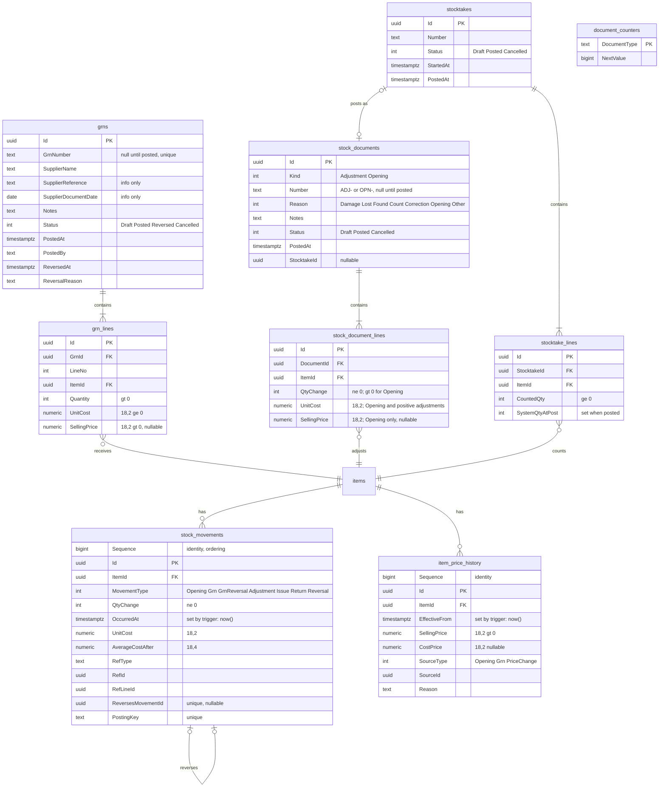

# Phase 3 Inventory — Design Proposal

Status: **draft, awaiting approval.** Nothing is built until you approve or amend the decisions below.

Spec: `Plan/Masterprompt.md`, `Plan/Phase3-Inventory core most critical.md` (including the 2026-11-17 review section).
Builds on: Phase 2 catalogue (`items`), Phase 1 permissions (`inventory.*` keys and the disabled Inventory menus).

---

## 0. Prerequisite (blocking)

Stock guarantees can only be proven on real PostgreSQL. Before coding:
1. Install **Docker Desktop** (or give me a throwaway PostgreSQL server for `TEST_POSTGRES_CONNECTION`, never the shop database).
2. Run the 25 skipped Phase 0–2 PostgreSQL tests and fix whatever they find.

If Docker is not possible on this machine, the fallback is GitHub Actions with a PostgreSQL service container (Phase 7 item, brought forward). Phase 3 is not "done" until its database tests have run somewhere.

## 1. Decisions needed before coding

| # | Decision | Recommendation |
|---|---|---|
| D1 | **Quantity precision** | Whole units, `integer`. Parts are sold by the piece. |
| D2 | **Valuation** | **Weighted average cost.** Each receipt recalculates the item's average; every movement stores `AverageCostAfter`, so the current average is the latest movement's value and historical margins never change. |
| D3 | **Average cost precision** | Money stays `numeric(18,2)` (receipt unit costs, prices). Only the running **average** cost is `numeric(18,4)`, because rounding it to cents on every receipt drifts. This is the one exception to Masterprompt rule 5 and needs your yes. |
| D4 | **Who sets the clock** | A database trigger sets `OccurredAt = now()` on every ledger and price-history insert, ignoring whatever the app sends. Backdating and future-dating become impossible even by bug. All rows in one posting share one timestamp; a `Sequence` identity column orders them. |
| D5 | **Ledger immutability** | `BEFORE UPDATE OR DELETE` triggers on `stock_movements` and `item_price_history` raise an error. Your Prisma database has a single owner user, so permission `REVOKE`s alone would not protect it. Lines of a posted document are protected the same way. |
| D6 | **No negative stock (concurrency)** | Every posting locks the affected **`items` rows** with `SELECT … FOR UPDATE` in item-id order (deterministic, works across several Azure instances, no extra table), inserts movements, then checks on-hand ≥ 0 before commit. Defence in depth: a **deferred constraint trigger** re-checks the item's total at commit. |
| D7 | **Selling price on a GRN line** | Optional. Pre-filled with the current price; if changed, the receipt writes a price-history row. Required only when the item has no price yet. |
| D8 | **Price changes without a receipt** | `POST /api/items/{id}/price` writes `item_price_history` (`SourceType = PriceChange`, reason). New key **`inventory.price`** (Admin by default, not StoreKeeper). |
| D9 | **Reversing a posted GRN** | Posts opposite movements **now**, linked to the originals. Rejected if any item would go below zero. Does not change selling prices (change them separately if needed). Average cost is recalculated; if the item reaches zero stock, the average stays as it was. New key **`inventory.reverse`** (Admin only). |
| D10 | **Document numbers** | Gapless per type (`GRN-000001`, `ADJ-000001`, `STK-000001`), allocated at posting from a `document_counters` row locked `FOR UPDATE`. Drafts have no number. Phase 4 reuses the same table for invoices. |
| D11 | **Drafts** | Editable and cancellable (`Status = Cancelled`, kept for audit). Only posting touches stock. |
| D12 | **Duplicate posting** | Posting an already-posted document returns it unchanged (idempotent). Each movement has a unique `PostingKey` (e.g. `grn-line:{lineId}`), so a retry can never post twice even under a race. |
| D13 | **Opening stock** | A document of kind `Opening` (same tables as adjustments): quantity, unit cost and selling price per item. Allowed only for items with **no movements yet** (unique partial index). Screen plus CSV import with dry run. |
| D14 | **Stocktake** | Count sheet → on posting, the system compares counts with on-hand **at that moment** and posts one adjustment (`Reason = Count`) for the differences. Counts entered while sales happen are the owner's responsibility; the screen shows a warning if stock moved since the sheet was started. |
| D15 | **Supplier** | Free text as the spec says, with suggestions from previous GRNs. Supplier invoice number and date are stored as information only and never affect posting time. |
| D16 | **Reservations** | Not in this phase. Available stock = on-hand until Phase 4; the code is written so Phase 4 adds reservations without changing these tables. |

## 2. Entity relationship diagram



Every table also has `CreatedAt, CreatedBy, UpdatedAt, UpdatedBy`. Immutable rows (`stock_movements`, `item_price_history`) keep `UpdatedAt = CreatedAt` and `UpdatedBy = CreatedBy` forever (the documented convention). No table stores an editable stock quantity.

## 3. Stock queries (executable, parameterized)

**Stock at an instant** (`@as_of_utc` exclusive, so a calendar date's end is the next shop-local midnight):

```sql
SELECT i."Id"  AS item_id,
       i."Sku" AS sku,
       i."Name" AS name,
       COALESCE(SUM(m."QtyChange"), 0) AS quantity
FROM items i
LEFT JOIN stock_movements m
       ON m."ItemId" = i."Id"
      AND m."OccurredAt" < @as_of_utc
WHERE i."IsDeleted" = false
GROUP BY i."Id", i."Sku", i."Name"
ORDER BY i."Name";
```

- Index: `stock_movements ("ItemId", "OccurredAt") INCLUDE ("QtyChange")`.
- The API takes either `asOf` (an exact instant) or `date` (a shop calendar date). `date=2026-03-31` becomes `@as_of_utc = 2026-04-01 00:00 Pacific/Auckland` converted to UTC with `ShopTime.GetUtcDayRange` (daylight saving handled), so the report shows stock at the **end** of 31 March in NZ.
- Before the first posting every item returns 0, so the system makes no claim about stock before it was set up.

**Current on-hand** uses the same query without the date condition. **Current price** is the latest `item_price_history` row by `Sequence`. **Current average cost** is `AverageCostAfter` of the latest movement by `Sequence`.

**Low stock**: `ReorderLevel IS NOT NULL AND on_hand <= ReorderLevel` (equal counts as low), showing `ReorderQuantity`.

## 4. Posting algorithm (one transaction)

1. Load the draft document `FOR UPDATE`; if already posted, return it (D12).
2. Lock the items: `SELECT "Id" FROM items WHERE "Id" = ANY(@ids) ORDER BY "Id" FOR UPDATE`.
3. Allocate the document number from `document_counters` (`FOR UPDATE`).
4. For each line: read on-hand and current average, compute `AverageCostAfter`, insert the movement (trigger stamps `OccurredAt`), insert price history if the price changed.
5. Check on-hand ≥ 0 for every locked item; otherwise roll back with a clear 409 naming the item.
6. Mark the document posted; commit. The deferred trigger re-checks totals at commit.

## 5. API

All errors are ProblemDetails; all input is validated with FluentValidation; lists are paged with whitelisted sorts.

| Method & route | Permission | Purpose |
|---|---|---|
| `GET /api/grns`, `GET /api/grns/{id}` | `inventory.grn` | List (status, supplier, date) and detail |
| `POST /api/grns`, `PUT /api/grns/{id}` | `inventory.grn` | Create / edit draft (header and lines) |
| `POST /api/grns/{id}/post` | `inventory.grn` | Post (idempotent) |
| `POST /api/grns/{id}/cancel` | `inventory.grn` | Cancel a draft |
| `POST /api/grns/{id}/reverse` | `inventory.reverse` | Reverse a posted GRN (reason required) |
| `GET /api/suppliers/suggestions?q=` | `inventory.grn` | Previous supplier names |
| `GET/POST/PUT /api/stock-adjustments…`, `/{id}/post`, `/{id}/cancel` | `inventory.adjust` | Adjustments |
| `GET/POST/PUT /api/opening-stock…`, `/{id}/post`; `POST /api/opening-stock/import?dryRun=true` | `inventory.adjust` | Opening stock and CSV import |
| `GET/POST/PUT /api/stocktakes…`, `/{id}/post`, `/{id}/cancel` | `inventory.adjust` | Stocktake |
| `GET /api/stock?date=&asOf=&q=&categoryId=` | `inventory.reports` | Stock list (now or at a date) |
| `GET /api/stock/low` | `inventory.reports` | Low-stock report |
| `GET /api/items/{id}/stock-card?from=&to=` | `inventory.reports` | Ledger with running balance |
| `POST /api/items/{id}/price` | `inventory.price` | Change selling price (reason) |
| `GET /api/items/{id}/price-history` | `inventory.reports` | Price history |

The existing `GET /api/items` gains read-only `onHand` and `sellingPrice` fields.

## 6. Admin screens

- **Goods received**: list; editor with fast line entry (type SKU or name, pick, quantity, unit cost, selling price pre-filled, Enter adds the next line), totals, Post with confirmation, Reverse for Admins.
- **Adjustments**: reason, lines with + / − quantities, Post.
- **Opening stock**: items with no stock yet, quantity / cost / price grid, CSV upload with dry-run preview.
- **Stocktake**: pick a category or items, enter counts, review differences, Post.
- **Stock report**: date picker ("Stock at end of") in NZ time, search, category filter, totals.
- **Low stock**: items at or below reorder level, with reorder quantity.
- **Item stock card**: movements with running balance, links to source documents; reached from the Items screen.
- **Price**: "Change price" on the item editor with history.
- Inventory menus enabled in `IdentitySeeder`, plus new menus for opening stock and stocktake.

## 7. Database changes (one migration: `Phase3Inventory`)

Tables in section 2; check constraints for quantities and money; unique `GrnNumber`/`Number` where not null; unique `PostingKey`; unique `ReversesMovementId`; unique partial index allowing one Opening movement per item; the triggers in D4–D6 written as raw SQL in the migration. A test confirms the triggers exist after migration.

## 8. Tests

**PostgreSQL (real database, required):** stock at several instants and dates including NZ daylight-saving changeover days; zero before first posting; immutable rows (UPDATE/DELETE fail); client-sent timestamps ignored; atomic rollback when one line fails; duplicate and concurrent posting of the same GRN (one posts); concurrent deductions on the same item never go negative; reversal rejected when stock was already used; price history unchanged by later GRNs; weighted average after several receipts and a reversal; opening stock only once per item; stocktake differences; gapless numbers under concurrency.
**Unit/API:** validators (quantities, money, reasons, CSV rows), permissions per endpoint (403 for StoreKeeper on price change and reversal), date-to-instant conversion, paging and sort whitelist.
**Admin web:** GRN line entry, post/reverse confirmations, as-of date picker sends the right date, stock card running balance.

## 9. Open questions for you

1. Approve **D3** (average cost stored with 4 decimals, the only exception to the 2-decimal money rule)?
2. **D8/D9**: should only Admins change prices and reverse GRNs, or StoreKeepers too?
3. Docker Desktop on this machine, or use GitHub Actions for the database tests (section 0)?
4. Do you need to receive fractional quantities (e.g. litres of oil)? If yes, D1 changes before the migration.
5. Prisma Postgres must allow PL/pgSQL triggers; I will confirm on a disposable hosted database before applying to the shop database.
