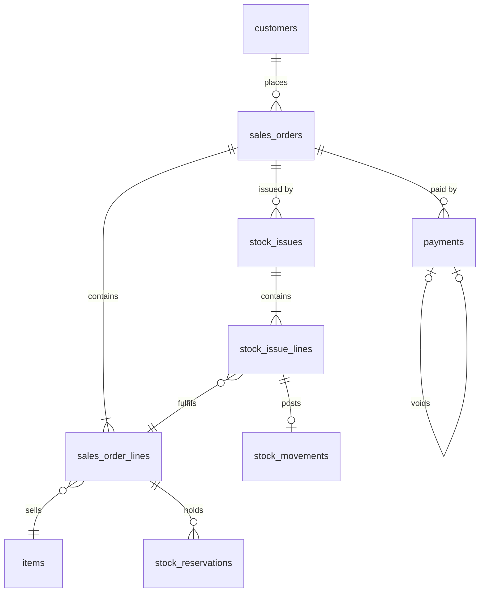

# Phase 4a Sales: Sell and Get Paid — Design Proposal

Status: **approved 2026-11-21** as written; recommendations taken for the open questions. Recorded in `docs/decisions/0005-sales.md`. One change while building: reservations are derived from confirmed lines minus issues instead of a separate `stock_reservations` table (same behaviour, nothing to drift).

Spec: `Plan/Masterprompt.md`, `Plan/Phase4- Sales invoices issue returns admin.md` (including the 2026-11-17 review, which splits Phase 4 into 4a and 4b).
Builds on: Phase 3 inventory (`StockLedger`, `stock_movements`, `document_counters`, the item-row `FOR UPDATE` lock protocol, DB-set `OccurredAt`, append-only triggers), Phase 1 permissions (`sales.*` keys, disabled Sales menus), Phase 2 catalogue.

**4a scope:** customers, sales orders and invoices, reservations, stock issue, payments, numbering, invoice PDF, order list, and the daily takings report.
**Left for 4b:** delivery settings and zones, shipments, returns, credit notes and manual refunds. 4a still stores a delivery snapshot on each order (method, address, charge typed in by staff), so 4b only adds the zone/quote and shipment logic on top.
**Not in Phase 4:** online orders, gateway payments and emailing invoices (all Phase 6).

---

## 1. Decisions needed before coding

| # | Decision | Recommendation |
|---|---|---|
| D1 | **Order vs invoice: one document or two?** | **One `sales_orders` row is the document.** As a draft it is a quote/order. On *Confirm* it gets an `INV-` number and becomes the invoice. A parts counter almost never needs an order that later turns into a different invoice document, and two tables would mean copying lines and keeping the copies in step. Phase 6 online orders use the same table (`Source = Online`). |
| D2 | **Separate state fields** | Three independent fields, all calculated by the server: `Status` (Draft → Confirmed → Completed, or Cancelled), `PaymentStatus` (Unpaid / PartiallyPaid / Paid / Overpaid), `FulfillmentStatus` (NotIssued / PartiallyIssued / Issued). "Partially paid and partially issued" is then just a combination of values, not a status of its own. `Completed` = fully paid **and** fully issued. `PayAfterDelivery` is a flag (`PaymentTerms = OnDelivery`), not a payment status. |
| D3 | **Numbering** | `INV-000001`, allocated at **Confirm** from `document_counters` (the Phase 3 counter, locked `FOR UPDATE`). Drafts have no number. Cancelled invoices keep their number. Payments get receipt numbers `RCT-000001`. Stock issues get `ISS-000001`. |
| D4 | **Reservations** | Made on Confirm for the full line quantity, in the same transaction, using the Phase 3 lock order. Confirm is rejected if *available* (on-hand − active reservations) is short. **Staff reservations do not expire.** They are released when the order is cancelled or consumed by an issue. Expiry columns exist (`ExpiresAt`, nullable) for Phase 6 but no background job is built now. |
| D5 | **Backorders** | Not allowed in 4a: you can only confirm what is in stock. (Optional later: confirm with a shortfall that shows as "awaiting stock".) |
| D6 | **Editing after Confirm** | Lines are frozen after Confirm, because the invoice now has a number. To change it, cancel it (before any issue or payment) and copy it to a new draft (a *Duplicate* button). After an issue or payment, corrections go through 4b returns and credit notes. |
| D7 | **Cancel** | Allowed only when nothing has been issued. If payments exist, cancel is blocked until 4b refunds exist. In 4a the screen says "refund needed first". New key `sales.cancel` (Admin by default). |
| D8 | **Prices** | Each line is pre-filled with the current selling price, and the line stores `ListPrice` (the price at that moment) and `UnitPrice` (the price charged). If `UnitPrice < ListPrice`, or there is any line or order discount, the user needs `sales.discount` and must give a reason. Raising the price above list price is allowed without the key. Prices are frozen at Confirm. Later price changes never touch the invoice. |
| D9 | **Discount and rounding** | Line discount as an amount or a %. It is turned into an amount per line, rounded half away from zero to cents (same `Money()` helper as Phase 3). An order-level discount is spread across lines in proportion to their value, using largest-remainder cent allocation so the parts add up exactly. This matters for 4b partial returns. Total = Σ line totals + delivery charge. No GST. |
| D10 | **Quantity precision** | 3 decimals, like Phase 3 (D1 there). Line total = round(qty × unit price) − discount. |
| D11 | **Tax snapshot** | Each order stores `TaxTreatment = NotRegistered`, `GstAmount = 0`, `IsGstRegistered = false`. A request that includes any GST field or tax amount ≠ 0 is rejected with 400. The PDF says "Invoice" plus "Not GST registered – no GST charged". It never says "Tax invoice". |
| D12 | **Issue** | *Issue stock* posts `ISS-` with chosen lines and quantities (partial allowed). In one transaction: lock items → consume the reservation → `StockLedger.Remove(…, MovementType.Issue, …)` at the current average cost → re-check no negative stock. `PostingKey = issue-line:{lineId}` plus an idempotency key prevent posting twice. Over-issue (more than ordered − already issued) is rejected. |
| D13 | **Payments** | Methods: Cash, EFTPOS/Card, BankTransfer, Other. Many partial payments per invoice. Each one needs a client-generated `IdempotencyKey` (unique), so a double-click or retry returns the same receipt. Payments are append-only. A mistake is fixed by a **void** entry (Admin, reason) that links to the original. Nothing is deleted. Overpayment is allowed but shown as `Overpaid` with the amount owing to the customer, which 4b refunds settle. Payments are allowed before issue (deposit) or after (pay on delivery). New key `payments.record` (Cashier + Admin). |
| D14 | **Customers** | A lightweight `customers` table: name, phone, email, company, billing address, default delivery address, notes. Search by name/phone. Optional: **Cash sale** has `CustomerId = null`. Each order *snapshots* name, contact and addresses, so editing a customer never changes old invoices. Phase 6 links an online login to this same table. |
| D15 | **Walk-in quick sale** | One screen action, *Quick sale*: create → confirm → issue all → record payment in a single request and transaction, for counter sales. Same rules as the separate steps. |
| D16 | **PDF library** | **QuestPDF Community** if the shop's annual gross revenue is under USD 1M (their current Community limit, which needs your confirmation). Otherwise **PdfSharp/MigraDoc (MIT)**. A4, shop details from config, printable and downloadable. The PDF is generated on demand from the stored snapshot. It is not stored. |
| D17 | **Daily takings** | A report per shop day (Pacific/Auckland, DST-aware): payments grouped by method with receipt and invoice numbers, voids shown separately, and totals. The refunds column is present but empty until 4b. Filtered by date range, printable/CSV. Uses key `sales.reports` (new, Admin + Cashier). |
| D18 | **Time** | Confirm, issue and payment timestamps come from the database (same trigger approach as Phase 3 D4). No backdating. |

### New permission keys (added to `PermissionKeys` and the seeded roles)

| Key | Admin | Cashier | StoreKeeper |
|---|---|---|---|
| `sales.invoice` (exists) | ✓ | ✓ | |
| `sales.discount` | ✓ | | |
| `sales.cancel` | ✓ | | |
| `sales.issue` (new: issue stock) | ✓ | ✓ | ✓ |
| `payments.record` | ✓ | ✓ | |
| `payments.void` | ✓ | | |
| `sales.reports` | ✓ | ✓ | |
| `customers.manage` | ✓ | ✓ | |

`creditnotes.issue` waits for 4b. The seeded menus `sales` and `sales.invoices` are switched on, and these are added: `sales.customers` and `sales.takings`. `sales.returns` stays off until 4b.

## 2. Data model (new migration `Phase4aSales`)

All tables have the standard audit fields. Money is `numeric(18,2)` and quantities `numeric(18,3)`.

- **customers**: Id, Name, Phone, Email, Company, BillingAddress (jsonb), DeliveryAddress (jsonb), Notes, IsActive.
- **sales_orders**: Id, InvoiceNumber (null until confirmed, unique), Source (Admin/Telephone/Online/Counter), Status, PaymentStatus, FulfillmentStatus, PaymentTerms (Immediate/OnDelivery), CustomerId?, snapshot fields (CustomerName, Phone, Email, BillingAddress, DeliveryAddress), DeliveryMethod (Pickup/Delivery), DeliveryCharge, Subtotal, DiscountTotal, Total, AmountPaid, BalanceDue, TaxTreatment, GstAmount (check = 0), Currency ('NZD'), ConfirmedAt/By, CancelledAt/By, CancelReason, Notes, RowVersion (xmin).
- **sales_order_lines**: Id, OrderId, LineNo, ItemId, Sku/Description snapshot, Quantity, ListPrice, UnitPrice, DiscountAmount, OrderDiscountShare, LineTotal, QtyIssued, DiscountReason. Checks: qty > 0, prices ≥ 0, 0 ≤ QtyIssued ≤ Quantity.
- **stock_reservations**: Id, OrderLineId, ItemId, Quantity, Status (Active/Consumed/Released), ExpiresAt?, ReleasedAt. Partial index on (ItemId) where Active. Reservations never write `stock_movements`.
- **stock_issues / stock_issue_lines**: number `ISS-`, posted at, lines → order line, qty, movement id.
- **payments**: Id, ReceiptNumber, OrderId, Method, Amount (> 0), Reference, ReceivedAt (DB time), IdempotencyKey (unique), VoidsPaymentId?, VoidReason. Append-only trigger like the ledger.
- Phase 3 change: **available stock** in `StockQueryService` and the stock screens = on-hand − active reservations (a new "Reserved" column).

Posted orders, their lines, issues and payments get the same `BEFORE UPDATE/DELETE` protection as Phase 3 posted documents. Only the server-maintained status/total columns on `sales_orders` stay updatable.

## 3. API (`/api/…`, ProblemDetails errors, FluentValidation)

| Method | Route | Permission |
|---|---|---|
| GET/POST/PUT | `/customers`, `/customers/{id}`, `/customers?search=` | customers.manage |
| GET | `/orders?status&paymentStatus&fulfillmentStatus&source&from&to&search&page` | sales.invoice |
| POST/PUT | `/orders`, `/orders/{id}` (draft only) | sales.invoice (+ sales.discount when discounted) |
| POST | `/orders/{id}/confirm` | sales.invoice |
| POST | `/orders/{id}/cancel` | sales.cancel |
| POST | `/orders/{id}/duplicate` | sales.invoice |
| POST | `/orders/quick-sale` | sales.invoice + sales.issue + payments.record |
| GET | `/orders/{id}`, `/orders/{id}/pdf` | sales.invoice |
| POST | `/orders/{id}/issues`, GET `/stock-issues/{id}` | sales.issue |
| POST | `/orders/{id}/payments` (Idempotency-Key header) | payments.record |
| POST | `/payments/{id}/void` | payments.void |
| GET | `/reports/daily-takings?from&to&format=csv` | sales.reports |

## 4. Files

**Backend**
- `Domain/Sales/SalesEntities.cs` (Customer, SalesOrder, SalesOrderLine, StockReservation, StockIssue(+Line), Payment, enums)
- `Application/Sales/SalesContracts.cs`, `SalesValidators.cs`, `SalesMath.cs` (pure rounding and allocation, unit-tested)
- `Infrastructure/Sales/OrderService.cs`, `ReservationService.cs` (extends `StockLedger` lock flow), `StockIssueService.cs`, `PaymentService.cs`, `CustomerService.cs`, `TakingsReportService.cs`, `InvoicePdfRenderer.cs`
- `Infrastructure/Persistence/Configurations/Sales*.cs`, migration `Phase4aSales` (tables, checks, triggers)
- `Api/Controllers/SalesControllers.cs`
- `PermissionKeys.cs`, `IdentitySeeder.cs` (keys, roles, menus); `StockQueryService.cs` (reserved/available)

**Admin web** (`src/admin-web/src/features/sales/`)
- `OrderListPage` (filters, status chips), `OrderEditorPage` (customer picker / cash sale, item search with available stock, lines, discounts with reason, delivery snapshot, live totals from a server preview call), `OrderDetailPage` (actions: Confirm, Issue, Record payment, Cancel, Duplicate, Print PDF; timeline of issues and payments), `QuickSalePage`, `CustomerPages`, `DailyTakingsPage`, `api.ts`, tests

**Docs**: `docs/decisions/0005-sales.md` (approved decisions), `docs/phase4a-sales.md` (run/test results).

## 5. Tests

*Unit*: rounding and largest-remainder allocation (sum always exact), discount permission rules, status derivation table (every combination of paid/issued), validators reject GST fields.

*Integration (real PostgreSQL, GitHub Actions)*:
- Confirm reserves; a second order cannot reserve the same last unit (concurrent confirms, exactly one wins).
- An inventory adjustment or GRN reversal cannot push on-hand below reserved + 0.
- Partial issue, then the rest; over-issue rejected; concurrent duplicate issue posts once; stock decreases exactly once.
- Cancel releases reservations; cancel is blocked after an issue or payment.
- Partial and multiple payments; the same idempotency key twice returns one receipt; concurrent payments keep the balance exact; void restores the balance; overpayment flagged.
- Historical price is kept after a later price change; customer edit does not change the invoice snapshot.
- Numbers are gapless under concurrency; drafts have none; cancelled keep theirs.
- Daily takings bucket by Pacific/Auckland day, including a DST-change day.
- Posted rows cannot be updated or deleted (triggers).

*Browser (Playwright)*: quick sale end to end; phone order → confirm → partial issue → partial payment → PDF downloads.

## 6. Open questions for you

1. D1: are you OK with a single order/invoice document?
2. D5: should staff ever confirm an order without stock (backorder), or is in-stock-only fine for now?
3. D16: is the shop's yearly revenue under the QuestPDF Community limit? If you're not sure, I'll use the MIT library.
4. What shop details should go on the invoice (trading name, address, phone, email, bank account for transfers, payment terms text)?
5. Payment methods: are Cash, EFTPOS/Card and Bank transfer enough? Anything else, like Afterpay or account customers?
6. D7/D13: Admin-only cancel and void. Should Cashier be allowed too?
7. Is `INV-000001` format OK, or would you like to continue from an existing number from your current invoice book?
